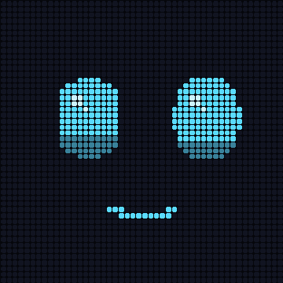

# robotformyson

Raspberry Pi 4 ＋小型正方形ディスプレイ＋カメラで動く、エンタメ用ロボットの「顔」デモ。




- 顔は 48×48 ドットのピクセルアート。LED マトリクスのような粒の見える画面で表示
- 15の表情（ふつう・うれしい・かなしい・おこる・びっくり・ねむい・だいすき・かんがえちゅう・てれる・おおわらい・わくわく・こまった・なく・ウインク・めがまわる）
- 眉・ほっぺの斜線・ハート目・星目・ぐるぐる目・涙・Z・？・怒りマークなどの小物つき
- まばたき、視線のゆらぎ、呼吸のような揺れを自動で付与。感情ごとに、はねる・ふるえる・ゆれるなどの動きも付く
- 表情が切りかわるときは目がぽよんとはずみ、目の形が変わるとき（ハート目など）は一度まばたきして入れかわる
- カメラで顔を見つけて、目で追いかける
- 人が来ると喜び、去ると悲しみ、40秒放置すると眠る（人が来ると起きる）
- タップで喜び、3回目で大笑い、5連打で怒り、さらに連打すると目が回る。なでる（ドラッグ）と照れてから大好きに。久しぶりに会うと目がきらきら
- 会話：話しかけると、感情つきで声で答える（話している間は口が動く）。考える部分は無料のローカル AI（Ollama）か Claude
- 「これなに？」と聞くと、カメラの画像を見て答える
- UDP で感情タグを受け付ける（外部プログラムとの連携口）

## 機材

| 役割 | 部品 | 状態 |
|---|---|---|
| 頭脳 | Raspberry Pi 4 Model B | 手元にある |
| 顔 | Pimoroni HyperPixel 4.0 Square（XP 版・720×720） | 手元にある |
| 会話の頭脳 | Mac mini（Ollama） | 手元にある |
| 目 | USB Web カメラ（サンワサプライ 400-CAM103） | 手元にある（Camera Module 3 も使える） |
| 耳 | SunFounder USB ミニマイク | 注文済み |
| 口 | Pi の 3.5mm 出力 → PAM8403 アンプ基板（USB 5V 給電）→ 3W 4Ω スピーカー ×2 | 注文済み |
| 手 | XIAO RP2040 ＋ SG90/MG90S サーボ ×2（サーボの 5V は XIAO から） | 用意する |
| 電源・記憶 | Pi 4 用 5V 3A USB-C 電源、microSD 32GB 以上 | 用意する（手持ちがあれば不要） |

- HyperPixel は GPIO ピンをすべて使いますが、カメラとマイクは USB、スピーカーは 3.5mm 端子なので、ピンは足りなくなりません。
- HyperPixel を上にかぶせると、Pi 4 の上に大きなファンを付けられません。CPU が熱くなりやすいので、薄型のヒートシンクを貼るか、ケースに空気の通り道を作ってください。
- カメラは画面のすぐ上に付けると、目が合っているように見えます。
- カメラモジュールを使うときは、フラットケーブルを HyperPixel と Pi の間を通して横から出します。

## HyperPixel 4.0 Square の設定

`/boot/firmware/config.txt` の最後に1行足して、再起動します（XP 版は OS 標準のドライバーで動きます）。

```
dtoverlay=vc4-kms-dpi-hyperpixel4sq
```

- Pimoroni の説明では、I2C と SPI は無効にしておく必要があります（`sudo raspi-config` → Interface Options。初期状態は無効です）。
- 正方形版は OS 側の画面回転にうまく対応していないため、向きはロボット側で `--screen-rotate 90`（または 180, 270）を付けて合わせます。
- タッチ対応版なら、画面のタップ・なでるがそのまま使えます。

## Raspberry Pi で動かす

Raspberry Pi OS（Bookworm）を想定しています。

```bash
sudo apt install -y python3-pygame python3-opencv python3-picamera2
git clone <このリポジトリ> && cd robotformyson
python3 -m robot.main --fullscreen
```

- USB カメラがあればそれを使い、なければカメラモジュール（picamera2）を使います。

### カメラ（ピコの目）の確認

USB カメラをさしたら、まずこれ:

```bash
python3 -m robot.camera list     # カメラとマイクの一覧。どれを目に使うか表示
python3 -m robot.camera check    # 5秒うつして、速さと顔が見えるかを調べる。写真は ~/camera_check.jpg
```

- Pi には `/dev/video10` などカメラではない映像デバイスもあるので、USB カメラを名前で自動で探します。
- 標準は 640x480・15fps・MJPG（Pi 4 で顔を追うのに十分で、軽い）。変えるときは
  `ROBOT_CAMERA_SIZE=320x240` / `ROBOT_CAMERA_FPS=10` / `ROBOT_CAMERA_FORMAT=YUYV`。
- カメラが2台あるときは `--camera-device CAM103`（名前の一部・番号・`/dev/video2`）か `ROBOT_CAMERA=CAM103`。
- 動いている途中で USB を抜いても、さしなおせば数秒でつなぎなおします。
- Web カメラのマイクは耳には使いません。`ROBOT_MIC=usb` のようにあいまいに指定しても、カメラのマイクは後回しにして USB ミニマイクを選びます（`tools/setup_audio.sh` も同じ）。
- 目の動きが小さい・大きいときは `--gaze-gain 1.6`、カメラが画面の上にあって目が下を向きすぎるときは `--gaze-offset-y -0.2` で調整します。
- 目が人と逆の方向を見るときは `--no-mirror` を付けてください。
- カメラを横向き・逆さに付けたときは `--rotate 90`（または 180, 270）で補正します。

## 会話機能を使う

聞く（Vosk）と話す（Open JTalk）は Pi の上でオフラインで動きます。考える部分は次から選べます。

| 頭脳 | 費用 | 会話 | 「これなに？」 |
|---|---|---|---|
| **A. 家の Mac mini の Ollama**（おすすめ・標準） | 無料（電気代のみ） | 自然な会話ができる | 見て答える |
| **B. 簡単会話モード**（Pi だけ） | 無料 | 決まった受け答えのみ | できない |
| **C. Claude API** | 1往復1〜2円ほど | いちばん賢い | 見て答える |

A と C は、Mac やネットにつながらないとき、自動で B に切り替わります（Mac が寝ていても、ロボットは黙りません）。

**試した結果（2026年11月）：** A の `gemma4:12b` は、恐竜の質問に「もういないんだよ」、コーヒーの写真に「それはコーヒーだね。おとながのむ飲みものだよ」、ナイフの質問に「あぶないから、おうちの人にきいてね」と、自然に答えました。
一方、Pi 4 で動く大きさ（1〜2B）のモデル（`qwen3:1.7b`、`gemma3:1b`）は、日本語の会話として成り立ちませんでした。「ないしょでナイフ使っていい？」に「いいよ！」と答えたこともあります。そのため Pi だけのときは、AI ではなく決まった受け答えにしています。

### まず Pi に入れるもの（共通）

```bash
# 音声合成と音声入出力のライブラリ
sudo apt install -y open-jtalk open-jtalk-mecab-naist-jdic hts-voice-nitech-jp-atr503-m001 libportaudio2

# Python のライブラリ（apt で入れた pygame などもそのまま使える仮想環境）
python3 -m venv --system-site-packages .venv && . .venv/bin/activate
pip install vosk sounddevice          # Claude も使うなら anthropic も

# 日本語の音声認識モデル（約50MB）
mkdir -p models && cd models
wget https://alphacephei.com/vosk/models/vosk-model-small-ja-0.22.zip && unzip vosk-model-small-ja-0.22.zip && cd ..
```

### A. Mac mini に考えてもらう

Mac mini 側（最初の1回だけ）:

1. https://ollama.com から Ollama をインストールして起動する。
2. ターミナルでモデルを入れる: `ollama pull gemma4:12b`（約8GB・画像も見られる）
3. 同じ Wi-Fi の Pi から使えるようにする:
   `launchctl setenv OLLAMA_HOST "0.0.0.0:11434"` を実行し、Ollama を再起動する。
   ファイアウォールの確認が出たら「許可」を選ぶ。Mac を再起動したときは、もう一度この設定が必要です。
4. システム設定の「エネルギー」で、自動でスリープしないようにする（寝ていると返事ができません）。

Pi 側（`macmini.local` は Mac の名前。システム設定 → 一般 → 共有 の下に表示されます）:

```bash
python3 -m robot.main --fullscreen --talk --ollama-url http://macmini.local:11434
```

返事が遅いときは、`ollama pull gemma4:e4b` で軽いモデルを入れて `--model gemma4:e4b` を付けてください。
参考：GPU のない Linux（4コア）では1回11〜15秒かかりました。Mac mini は GPU を使うので、ずっと速くなるはずです。

### B. 簡単会話モード（Pi だけ）

```bash
python3 -m robot.main --fullscreen --talk --brain simple
```

あいさつ・名前・「いたい」「ナイフ」などの言葉に、決まった返事をします（`robot/conversation.py` の `SimpleBrain.RULES` で増やせます）。

### C. Claude を使う

```bash
pip install anthropic
export ANTHROPIC_API_KEY=...   # https://platform.claude.com で発行
python3 -m robot.main --fullscreen --talk --brain claude
```

標準のモデルは `claude-opus-5-5`（考える深さは low）です。安く速くしたいときは `--model claude-haiku-5-5` を付けてください。

### 共通の設定

- **いつ返事をするか：** カメラに顔が見えているとき（10秒以内）か、名前（標準は「ピコ」）を呼ばれたときです。名前はひらがな・カタカナどちらで聞き取っても反応します。返事のあと15秒は、続けて話しかけられます。テレビの音などに反応しすぎないためです。
- **名前と声：** `--name ロボ` で名前、`--pitch 3` で声の高さを変えられます。もっとかわいい声にしたいときは、MMDAgent の「mei」の声ファイルを `/usr/share/hts-voice/mei/` に置くと自動で使います（`--voice` でファイルを指定することもできます）。
- **マイク・スピーカーを変えるとき：** 下の「声の入り口と出口」を見てください。
- **会話だけ試す：** `python3 -m robot.conversation --text --ollama-url http://macmini.local:11434` で、キーボードから話しかけられます（マイク不要。Mac の上で直接動かしても試せます）。

### 声の入り口と出口（エコー除去）

高いエコー除去基板は使わず、ソフトで2段構えにしています。

1. **PipeWire の WebRTC エコー除去**：スピーカーから出た音をマイクの音から引く。
2. **話している間はマイクを止める**：ロボットが話している間と、話し終えてから 0.6 秒は、マイクの音を捨てます。話しはじめる前に聞きかけていた言葉の切れ端も捨てます。ソフトのエコー除去は完全ではないので、自分の声に返事をしてしまわないための保険です。そのかわり、ロボットが話している途中で割りこんで話しかけることはできません。

機材がそろったら、Pi で1回だけ実行します（Raspberry Pi OS Bookworm のデスクトップ版を想定）:

```bash
bash tools/setup_audio.sh --dry-run   # 見つけたマイク・スピーカーと、作る設定を表示するだけ
bash tools/setup_audio.sh             # 設定して、エコー除去したマイク・スピーカーを標準にする
python3 -m robot.audio check          # 音を鳴らしながら録音して、回り込みの大きさを測る
```

- USB マイクは名前に「usb」、3.5mm 出力は「bcm2835」を含むものを選びます。ちがうときは `wpctl status` で名前を見て、`MIC_MATCH=pnp SPEAKER_MATCH=headphones bash tools/setup_audio.sh` のように指定します。
- 元に戻すときは `bash tools/setup_audio.sh --undo` です。
- 3.5mm から音が出ないときは、`/boot/firmware/config.txt` に `dtparam=audio=on` があるか確認してください。
- PAM8403 は小さな音でもよく増幅するので、Pi 側の音量は 70% くらいから試してください（`wpctl set-volume @DEFAULT_AUDIO_SINK@ 0.7`）。サーというノイズが気になるときは、アンプの電源を Pi の USB ではなく別の USB 充電器からとると減ることがあります。
- マイクはスピーカーからなるべく離し、スピーカーの正面に向けないようにすると、エコー除去がよく効きます。

ロボットは何も指定しなければシステム標準（設定後はエコー除去済み）を使います。別のデバイスを使うときは、名前の一部か番号で指定します。

```bash
python3 -m robot.audio list                                   # 一覧
python3 -m robot.main --talk --mic USB --speaker Headphones   # 引数で
ROBOT_MIC=USB ROBOT_SPEAKER=Headphones python3 -m robot.main --talk   # 環境変数で
```

| 設定 | 引数 | 環境変数 | 標準 |
|---|---|---|---|
| マイク | `--mic` | `ROBOT_MIC` | システム標準 |
| スピーカー | `--speaker` | `ROBOT_SPEAKER` | システム標準 |
| 話し終えてからマイクを戻すまで（秒） | `--echo-tail` | `ROBOT_ECHO_TAIL` | 0.6 |

自分の声の終わりに返事をしてしまうときは `--echo-tail 1.0` のように長くし、返事のあとすぐ話しかけても聞きのがすときは短くします。

### 子ども向けの安全とプライバシー

- システムプロンプト（`robot/conversation.py` の `SYSTEM_PROMPT`）で、短くやさしい返事・危ないことはおうちの人に聞く・個人情報を聞かない、と指示しています。
- Ollama の小さなモデルは Claude より指示を守りにくいため、返事に不適切な言葉（`NG_WORDS`）が入っていたら、別の話題に言いかえます。気になる言葉があれば足してください「むかしね」「イエロー」のような、ふつうの言葉の誤判定は `NG_OK_WORDS` で除いています。
- 返事は、声に出すのは最初の2文（80文字くらい）までに切りつめます。長い説明で子どもが飽きないためです。
- Claude は、安全上の理由で答えを断ったとき、サーバー側で別のモデルに自動で切り替えます（`fallbacks="default"`）。それでも断られた場合は「そのおはなしはできない」と答えます。
- A と B では、声も画像も家の外に出ません。C では、聞き取った文字と、「これ」「見て」などと言ったときのカメラ画像1枚だけを送ります。
- 会話の履歴は直近10往復だけをメモリに置き、ファイルには保存しません。

## 家族の顔をおぼえる

カメラで家族の顔を見分けて、「おかえり、ゆうとくん！」のように名前で呼んであいさつします。

```bash
python3 -m robot.faces download   # 顔を見分けるモデル（約39MB）を models/ に入れる。最初に1回だけ
```

これで `python3 -m robot.main --talk` を起動すると使えるようになります（モデルがなければ、この機能なしで動きます。`--no-faces` で止めることもできます）。

**登録（子どもだけでできます）**

1. 「ピコ、かおを おぼえて」と話しかける
2. 「おなまえ おしえて？」と聞かれたら、名前を言う（「ゆうと」「ぼくは ゆうと だよ」など）
3. 「ゆうと、で あってる？」に「うん」と答える。ちがうときは「ちがう」で言いなおせます。「やめる」でいつでも中止
4. 「カメラを みて にっこりしてね！」のあと、数秒カメラを見る（1人だけ写るように）
5. 「おぼえたよ！」で完了。同じ名前でもう一度登録すると、その人の顔が増えて、見分けやすくなります

**おうちの人向けの設定**

```bash
python3 -m robot.faces list                         # 登録した人の一覧
python3 -m robot.faces add ママ                      # 会話機能なしで登録（カメラを見る）
python3 -m robot.faces set ゆうと --call ゆうとくん   # 呼び方を変える（最初は名前そのまま）
python3 -m robot.faces set ゆうと --emotion love     # あいさつのときの表情を人ごとに変える
python3 -m robot.faces forget ゆうと                 # 登録を消す（--all で全員）
```

- あいさつは同じ人に30分に1回まで。朝（5〜10時）は「おはよう」、2時間以上会っていなければ「おかえり」、それ以外は「あ、ゆうとくんだ！」です。
- 会話の頭脳には「（話しているのは ゆうとくん）」と付けて伝えるので、名前を呼んで返事できます。
- 別の人の顔とそっくりなまま別の名前で登録しようとすると、まちがい防止のため登録しません（きょうだいがよく似ているときなど）。そのときは `python3 -m robot.faces add` で、おうちの人が登録してください。

**プライバシー**

- 顔の写真は保存しません。保存するのは顔の特徴（128個の数字）と名前・呼び方だけで、`~/.local/share/robot/faces.json` に、Pi のユーザーだけが読める権限（600）で置きます。
- 顔を見分ける処理はすべて Pi の中で動き、Mac mini やインターネットには何も送りません。Pi 4 でも1回あたり0.2秒ほどの見込みで、1秒に1回調べるだけなので、Mac mini に任せる必要はありません。
- 置き場所は `ROBOT_DATA=/別の/フォルダ` で変えられます。

**ほかの機能から使う**

```python
faces.current()                 # いま見えている人: ("p1", "ゆうと") / (None, None)
faces.on_change(callback)       # 見えている人が変わったら callback(person_id, name)
faces.person("p1")              # 呼び方・あいさつの表情・最後に見た時刻など
```

`person_id` は登録したときに決まり、名前を変えても、ほかの人を消しても変わりません（使いまわしません）。

## PC で試す

```bash
pip install -r requirements.txt
python3 -m robot.main            # Web カメラがあれば顔を追う
python3 -m robot.main --mouse    # カメラなし：マウスを人の顔として扱う
```

## 操作

| 入力 | 動作 |
|---|---|
| `1`〜`9` | neutral / joy / sad / angry / surprise / sleepy / love / think / shy を4秒出す |
| `←` `→` | 全15種類の表情を順番に4秒ずつ出す |
| `0` | 自動モードに戻す |
| `c` | カメラ映像と検出枠を表示 |
| `d` | 感情名・顔検出・FPS を表示 |
| `q` / `Esc` | 終了 |
| タップ・ドラッグ | 喜ぶ・照れる（タッチ対応ディスプレイならそのまま使える） |

## 成長（なかよし度）

話しかける・なでる・タップする・顔を見せると「なかよし度」がたまり、5段階で育ちます。
1日にたまる量に上限（40）があるので、毎日10分くらい遊ぶと次のくらいで上がります。

| レベル | 目安 | 変わること |
|---|---|---|
| 1 はじめまして | 初日 | ていねいで少し照れた話し方 |
| 2 ともだち | 2〜3日 | 名前を呼んで「おかえり！」 |
| 3 なかよし | 1週間 | なでるとハートが多くなる、くだけた話し方 |
| 4 しんゆう | 2週間 | 「きのう遊んだ」など前のことにふれる |
| 5 だいしんゆう | 1か月 | 自分から なぞなぞ・しりとりに さそう |

- レベルが上がると、びっくりしてから大喜びして「やったあ！ ○○に なれたよ！」と言います。
- 1日以上会わないと、次に会ったとき少しさみしそうにします。なかよし度は減りません。
- 顔をおぼえる機能が誰かを教えてくれると、人ごとに記録します（`faces.on_change(growth.set_person)`）。わからないときは「みんな」として記録します。
- 記録は Pi の中の `~/.local/share/robot/growth.json` だけです（`ROBOT_GROWTH_FILE` で変更可）。日ごとの回数と時間だけで、会話の中身は保存しません。
- 記録しないときは `--no-growth`。`d` キーのデバッグ表示にレベルとなかよし度が出ます。

```bash
python3 -m robot.growth          # 今のレベル
python3 -m robot.growth report   # 家族向け：この1週間のまとめ
python3 -m robot.growth reset    # 記録を消して最初から
```

## ピコの庭（なかよし度で育つ植物）

画面の背景に、家族ひとりに1本ずつ植物が生えます。形は人ごとに決まっていて、なかよし度がたまるほど伸びます。

| レベル | 庭のようす |
|---|---|
| 1 はじめまして | 小さな芽 |
| 2 ともだち | 葉が出る |
| 3 なかよし | 枝分かれして大きくなる |
| 4 しんゆう | つぼみ |
| 5 だいしんゆう | 花が咲く。今いっしょにいる人の植物のまわりに光の粒（夜はほたる） |

- 今ピコの前にいる人（顔をおぼえる機能で見分けた人）の植物が明るくなります。だれかわからないときは「みんな」の1本だけです。植物は、なかよし度の高い4人までです。
- 顔の上（眉より上のすきま）に空（昼・夕方・夜で変わる）、下に地面と草むらが出ます。背の高い植物は顔のうしろにうっすら見え、花は顔のうしろでも明るいままです。縦長の画面（480×800 など）なら、顔の上下が帯になって広くなります。
- 画面全体を顔と同じ 48 ドット幅で描くので、Pi 4 でも 30fps で動く軽さです（PC で1フレーム約2ms）。
- 成長の記録（growth.json）を読むだけで、新しく保存するものはありません。
- 出したくないときは `--no-garden`。PC で庭だけ見るときは `python3 -m robot.garden`（`1`〜`5` キーでレベル、`Tab` で人を切りかえ）。

## 性格（好奇心いっぱいの年下の友達）

ふだんのピコは、好奇心いっぱいの「少し年下の友達」です。「なんでかな？」と一緒にふしぎがり、
しりとりやなぞなぞでは ときどき まちがえて「もういっかい やってみる！」と明るくやり直します。
がんばったら、結果より やり方をほめます。本当のこと（生きもの・からだ・あぶないこと）は
わざとまちがえず、自信がないときは「おうちの人にも聞いてみよう」とさそいます。

```bash
python3 -m robot.main --talk --personality curious   # ふつうはこれ（省略可）
python3 -m robot.main --talk --personality plain     # 性格の指示なし（前と同じ）
python3 -m robot.main --talk --personality weekly    # 週ごとに入れかえて比べる（偶数週が curious）
```

`weekly` のときは、`python3 -m robot.growth report` の週ごとの遊んだ回数を見比べると、性格のちがいがわかります。

## 話し方に合わせる（ことば）

ピコは、話した長さ（聞き取れた文字数）を人ごとに日ごとで数え、直近7日の平均で話し方を3段階から選びます。
短い言葉が多い子には短くやさしく、たくさん話す子には ときどき少しむずかしい言葉を意味つきで使います。
20回話すまでは ふつうの話し方です。保存するのは数字だけで、声や会話の全文は残しません。

親が「今週のことば」を決めると、ピコが会話に自然に混ぜ、子どもが自分で言った回数も数えます。

```bash
python3 -m robot.language word とうめい "すけて むこうが見えること"   # 7日間
python3 -m robot.language                 # ことばの記録（話した回数・平均の長さ・今週のことば）
python3 -m robot.language word --clear    # 今週のことばをやめる
python3 -m robot.language reset           # 記録を消す
```

子どもの声の聞き取りはまちがいが多いので、数字は大まかな目安です。`--no-language` で切れます。
保存場所は `~/.local/share/robot/language.json`（`ROBOT_LANGUAGE_FILE` で変更可）。

## 前に話したことをおぼえる（記憶）

顔をおぼえた人と話すと、会話が一区切りしたとき（1分話さない・相手が入れかわった）に、
「好きなもの・はまっている遊び・楽しみな予定」を最大3つの短いメモにします。
次にその人の顔を見分けたら、新しいメモ3つを会話の指示に入れるので、
「きのうの恐竜、名前きまった？」のように自然に話題にできます。

- 使うには、会話機能（`--talk`）と顔をおぼえる機能の両方が必要です。知らない人の話はおぼえません。
- メモを作るのは家の中の Ollama（Mac mini）だけです。`--brain claude` のときは外に送らないよう、メモを作りません。
- 保存するのは短いメモだけで、声や会話の全文は残しません。住所・電話・学校や園の名前・体や病気・家族のけんか・ひみつ などは除きます。
- メモは 90日で消え、1人 20件までです。
- 子どもが「いまの わすれて」と言うと、その会話はおぼえません。
- 小さい子には記憶がない方が楽しいこともあるので（Leite ら 2017）、`--no-memory` で切れます。

```bash
python3 -m robot.memory               # おぼえていることの一覧
python3 -m robot.memory forget ゆうと   # その人のメモを消す
python3 -m robot.memory reset         # ぜんぶ消す
```

保存場所は `~/.local/share/robot/memory.json`（`ROBOT_MEMORY_FILE` で変更可）。

## はい・いいえと字幕

- 返事が「うん」「はい」で始まると、顔が2回うなずいて右下に緑の〇、「ううん」「いいえ」なら首を横にふって赤い×を出します（AI には、はい・いいえで答えられる質問には最初に「うん」か「ううん」を言うように伝えています）。
- 画面の上に字幕を出します。聞き取った言葉はうすい色の「」で、イモの返事は白で。スピーカーがなくても何と言ったか読めます。
- 字幕には日本語のフォントが要ります。Pi では `sudo apt install -y fonts-noto-cjk`。出したくないときは `--no-caption`。

## 手を動かす（左右の2本）

箱の左右の壁に入れたサーボ2個で、手を動かします。XIAO RP2040 を USB でさせば自動でつながり、なければ手なしで動きます。部品・配線・書きこみは [firmware/arms_xiao/README.md](firmware/arms_xiao/README.md)。

| どんなとき | 手の動き |
|---|---|
| うれしい / わくわく / びっくり | 両手をぱたぱた / バンザイしてゆらす / ぱっと両手をあげる |
| かなしい・ねむい | だらんとおろす |
| てれる / 考えちゅう / こまった | 両手で顔をかくす / 片手をあごに / 頭をかく |
| 話している間 | 声に合わせて手を少しずつ動かす |
| 「バイバイ」「こんにちは」・家族が来た | 右手をふる |
| 「バンザイ」「やったー」 | バンザイ |
| なでられた | もじもじ |
| だれもいない | ほとんどおろしたまま（電池の節約）、ときどき片手を少し |

```bash
python3 -m robot.arms down    # 手をおろした位置で止める（ホーンを付けるとき）
python3 -m robot.arms test    # 左手 → 右手 → バンザイ → バイバイ
```

## 外部プログラムとの連携口

ポート 5005（localhost）に `感情名 秒数` を UDP で送ると、その表情を出します。

```bash
echo "joy 3" | nc -u -w0 127.0.0.1 5005
```

別のプログラムから表情を動かしたいときに使います。

## 構成

| ファイル | 役割 |
|---|---|
| `robot/face.py` | 表情の描画（ピクセルアート）。感情ごとのパラメータを補間し、小物や動きを付けて描く。`EMOTIONS` に足せば表情を増やせる。`python3 tools/preview.py out.gif` で動きを GIF にできる（Pillow が必要） |
| `robot/emotion.py` | 感情エンジン。顔・タッチ・外部指示から今の感情を決める |
| `robot/vision.py` | カメラと顔検出（別スレッド）。USB を抜いてもつなぎなおす |
| `robot/camera.py` | 目にするカメラを探して開く（USB カメラ優先・Pi 4 向けの設定）・確認コマンド |
| `robot/conversation.py` | 会話：聞く（Vosk）・考える（Ollama / Claude）・話す（Open JTalk） |
| `robot/main.py` | 起動・入力処理・画面更新 |
| `robot/growth.py` | 成長：人ごとのなかよし度・レベル・家族向けの記録 |
| `robot/garden.py` | ピコの庭：なかよし度で育つ人ごとの植物（背景） |
| `robot/screen.py` | 画面全体を顔と同じドットで描く（顔のまわりと顔のうしろに背景） |
| `robot/audio.py` | マイク・スピーカーの選択、話している間マイクを止める仕組み、音の回り込みチェック |
| `tools/setup_audio.sh` / `deploy/pipewire/` | PipeWire のエコー除去の設定 |
| `tools/snapshot.py` | 全表情を1枚の画像に書き出す（確認用） |
| `robot/faces.py` | 家族の顔をおぼえて見分ける・あいさつ・声での登録 |
| `robot/personality.py` | 好奇心いっぱいで まちがえても大丈夫を見せる性格 |
| `robot/language.py` | 話し方に合わせて言葉のむずかしさを変える・今週のことば |
| `robot/memory.py` | 前に話したことを人ごとにおぼえる（家の中だけに保存） |
| `robot/arms.py` / `firmware/arms_xiao/` | 手の動き（表情・会話から角度を決める）と、サーボを動かす XIAO のプログラム |
| `tests/` | 会話・音声・成長・顔をおぼえる・記憶のテスト |

## テスト

マイク・スピーカー・API キー・Ollama がなくても、会話の流れを確かめられます（偽の Ollama サーバーと偽の Claude を使います）。

```bash
pip install pytest numpy anthropic
python3 -m pytest tests
```
