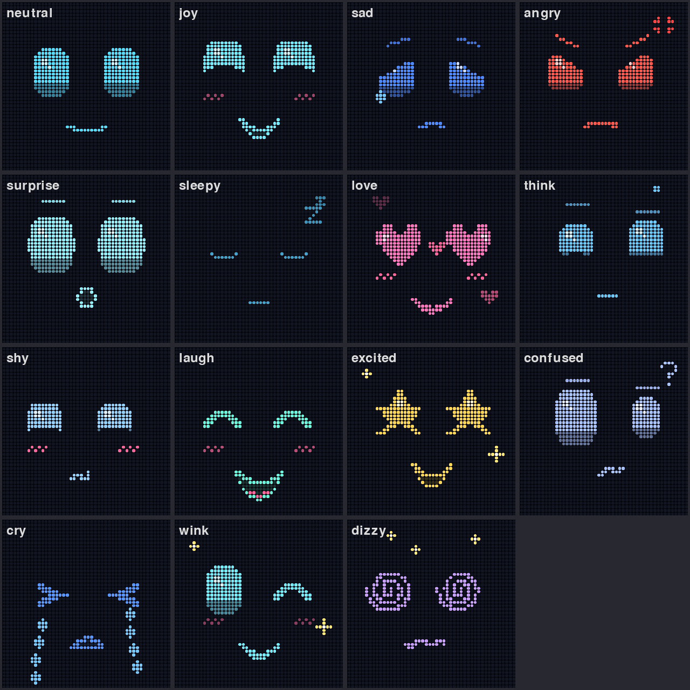

# robotformyson

Raspberry Pi 4 ＋小型正方形ディスプレイ＋カメラで動く、エンタメ用ロボットの「顔」デモ。



- 8つの表情（ふつう・うれしい・かなしい・おこる・びっくり・ねむい・だいすき・かんがえちゅう）
- まばたき、視線のゆらぎ、呼吸のような揺れを自動で付与
- カメラで顔を見つけて、目で追いかける
- 人が来ると喜び、去ると悲しみ、40秒放置すると眠る（人が来ると起きる）
- タップで喜び、5連打で怒り、なでる（ドラッグ）と照れる
- 会話：話しかけると、感情つきで声で答える（話している間は口が動く）。考える部分は無料のローカル AI（Ollama）か Claude
- 「これなに？」と聞くと、カメラの画像を見て答える
- UDP で感情タグを受け付ける（外部プログラムとの連携口）

## Raspberry Pi で動かす

Raspberry Pi OS（Bookworm）を想定しています。

```bash
sudo apt install -y python3-pygame python3-opencv python3-picamera2
git clone <このリポジトリ> && cd robotformyson
python3 -m robot.main --fullscreen
```

- カメラモジュールは picamera2、USB カメラは OpenCV で自動的に選ばれます。
- 目が人と逆の方向を見るときは `--no-mirror` を付けてください。
- カメラを横向き・逆さに付けたときは `--rotate 90`（または 180, 270）で補正します。

## 会話機能を使う

聞く（Vosk）と話す（Open JTalk）は Pi の上でオフラインで動きます。考える部分は3通りから選べます。

| 頭脳 | 費用 | 賢さ・速さ | 「これなに？」 |
|---|---|---|---|
| **A. 家の Mac mini の Ollama**（標準のおすすめ） | 無料（電気代のみ） | 実用的・速い | 見て答える |
| **B. Pi 4 自身の Ollama** | 無料 | たどたどしい・遅め | 見えないと答える |
| **C. Claude API** | 1往復1〜2円ほど | いちばん賢い | 見て答える |

### まず Pi に入れるもの（共通）

```bash
# 音声合成と音声入出力のライブラリ
sudo apt install -y open-jtalk open-jtalk-mecab-naist-jdic hts-voice-nitech-jp-atr503-m001 libportaudio2

# Python のライブラリ（apt で入れた pygame などもそのまま使える仮想環境）
python3 -m venv --system-site-packages .venv && . .venv/bin/activate
pip install vosk sounddevice          # Claude も使うなら anthropic も

# 日本語の音声認識モデル（約50MB）
mkdir -p models && cd models
wget https://alphacephei.com/vosk/models/vosk-model-small-ja-0.22.zip && unzip vosk-model-small-ja-0.22.zip && cd ..
```

### A. Mac mini に考えてもらう

Mac mini 側（最初の1回だけ）:

1. https://ollama.com から Ollama をインストールして起動する。
2. ターミナルでモデルを入れる: `ollama pull gemma4:12b`（約8GB・画像も見られる）
3. 同じ Wi-Fi の Pi から使えるようにする:
   `launchctl setenv OLLAMA_HOST "0.0.0.0:11434"` を実行し、Ollama を再起動する。
   ファイアウォールの確認が出たら「許可」を選ぶ。Mac を再起動したときは、もう一度この設定が必要です。
4. システム設定の「エネルギー」で、自動でスリープしないようにする（寝ていると返事ができません）。

Pi 側（`macmini.local` は Mac の名前。システム設定 → 一般 → 共有 の下に表示されます）:

```bash
python3 -m robot.main --fullscreen --talk --ollama-url http://macmini.local:11434
```

返事が遅いときは、`ollama pull gemma4:e4b` で軽いモデルを入れて `--model gemma4:e4b` を付けてください。

### B. Pi 4 だけで動かす

```bash
curl -fsSL https://ollama.com/install.sh | sh   # Pi に Ollama を入れる
ollama pull qwen3:1.7b                          # 約1.4GB
python3 -m robot.main --fullscreen --talk
```

- Pi の上で `--ollama-url` を付けずに起動すると、自動で小さいモデル（`qwen3:1.7b`）を使います。
- 遅すぎるとき、または Pi のメモリが 2GB のときは、`qwen3:0.6b`（約0.5GB）を pull して `--model qwen3:0.6b` を試してください。賢さはさらに下がります。
- このモデルは画像を見られないので、「これなに？」には「見えない」と答えます。

### C. Claude を使う

```bash
pip install anthropic
export ANTHROPIC_API_KEY=...   # https://platform.claude.com で発行
python3 -m robot.main --fullscreen --talk --brain claude
```

標準のモデルは `claude-opus-5-5`（考える深さは low）です。安く速くしたいときは `--model claude-haiku-5-5` を付けてください。

### 共通の設定

- **いつ返事をするか：** カメラに顔が見えているとき（10秒以内）か、名前（標準は「ピコ」）を呼ばれたときです。返事のあと15秒は、続けて話しかけられます。テレビの音などに反応しすぎないためです。
- **名前と声：** `--name ロボ` で名前、`--pitch 3` で声の高さを変えられます。もっとかわいい声にしたいときは、MMDAgent の「mei」の声ファイルを `/usr/share/hts-voice/mei/` に置くと自動で使います（`--voice` でファイルを指定することもできます）。
- **マイクが違うとき：** `python3 -m sounddevice` で一覧を出し、`--mic 番号` で指定します。
- **会話だけ試す：** `python3 -m robot.conversation --text --ollama-url http://macmini.local:11434` で、キーボードから話しかけられます（マイク不要。Mac の上で直接動かしても試せます）。

### 子ども向けの安全とプライバシー

- システムプロンプト（`robot/conversation.py` の `SYSTEM_PROMPT`）で、短くやさしい返事・危ないことはおうちの人に聞く・個人情報を聞かない、と指示しています。
- Ollama の小さなモデルは Claude より指示を守りにくいため、返事に不適切な言葉（`NG_WORDS`）が入っていたら、別の話題に言いかえます。気になる言葉があれば足してください。
- Claude は、安全上の理由で答えを断ったとき、サーバー側で別のモデルに自動で切り替えます（`fallbacks="default"`）。それでも断られた場合は「そのおはなしはできない」と答えます。
- A と B では、声も画像も家の外に出ません。C では、聞き取った文字と、「これ」「見て」などと言ったときのカメラ画像1枚だけを送ります。
- 会話の履歴は直近10往復だけをメモリに置き、ファイルには保存しません。

## PC で試す

```bash
pip install -r requirements.txt
python3 -m robot.main            # Web カメラがあれば顔を追う
python3 -m robot.main --mouse    # カメラなし：マウスを人の顔として扱う
```

## 操作

| 入力 | 動作 |
|---|---|
| `1`〜`8` | neutral / joy / sad / angry / surprise / sleepy / love / think を4秒出す |
| `0` | 自動モードに戻す |
| `c` | カメラ映像と検出枠を表示 |
| `d` | 感情名・顔検出・FPS を表示 |
| `q` / `Esc` | 終了 |
| タップ・ドラッグ | 喜ぶ・照れる（タッチ対応ディスプレイならそのまま使える） |

## 外部プログラムとの連携口

ポート 5005（localhost）に `感情名 秒数` を UDP で送ると、その表情を出します。

```bash
echo "joy 3" | nc -u -w0 127.0.0.1 5005
```

別のプログラムから表情を動かしたいときに使います。

## 構成

| ファイル | 役割 |
|---|---|
| `robot/face.py` | 表情の描画。感情ごとのパラメータを補間して描く |
| `robot/emotion.py` | 感情エンジン。顔・タッチ・外部指示から今の感情を決める |
| `robot/vision.py` | カメラと顔検出（別スレッド） |
| `robot/conversation.py` | 会話：聞く（Vosk）・考える（Ollama / Claude）・話す（Open JTalk） |
| `robot/main.py` | 起動・入力処理・画面更新 |
| `tools/snapshot.py` | 全表情を1枚の画像に書き出す（確認用） |
